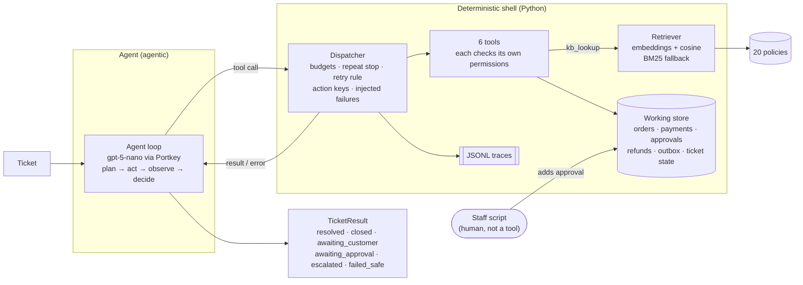
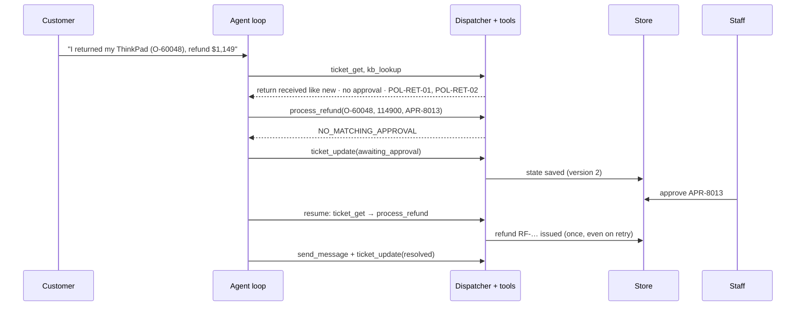

# OP-US Support-Ticket Triage Agent

Team OP-US · Agentic AI, UT Austin, Fall 2026

An AI agent that reads customer support tickets for a fictional online store, finds the
relevant store policies, takes safe actions (refunds, cancellations, replies), and saves each
ticket in a clear end state. It can also pause for missing information or a staff approval
and resume later.

**Core rule: Python owns permissions and control flow, not the model.** The model decides
*how* to handle a ticket; Python decides *what is allowed*. Nothing written in a ticket or a
policy can grant a permission, and a refund only happens with a staff approval for the exact
order and amount.

---

## How it works



### Pause for approval, then resume (the demo path, ticket T-0039)



---

## Tech stack

| Area | Choice |
|---|---|
| Language | Python 3.12 |
| Environment | [uv](https://docs.astral.sh/uv/) with `pyproject.toml` + `uv.lock` |
| LLM | `gpt-5-nano` through **Portkey** (OpenAI-compatible API) |
| Embeddings | `text-embedding-3-small` through Portkey |
| Keyword search | `rank-bm25` (BM25Okapi) |
| Data validation | Pydantic v2, strict models (extra fields rejected) |
| Agent loop | Plain Python loop with native function calling (no agent framework) |
| State | JSON files in `runtime/`, written after every action |
| Tests | pytest |

---

## Repository layout

```
agent/
  config.py          paths, model IDs, per-ticket limits (4 model calls, 6 tool calls, ...)
  schemas.py         TicketResult, categories, statuses, team routing, ToolError / StopRun
  store.py           working store in runtime/, safe writes, balance and lookup helpers
  tools.py           the 6 tools and their permission checks
  dispatcher.py      the only path from a model tool call to a tool
  retrieval.py       policy chunks, embeddings + cosine, BM25 fallback
  llm.py             Portkey client and embeddings
  eval_retrieval.py  Hit@3 / Recall@3 / Precision@3 / MRR for retrieval
  trace.py           JSONL traces, card numbers removed
  staff.py           human staff actions: reset, approve, status
data/
  synthetic/         160 tickets, labels, provenance, store, splits (dev 44 / test 115 / demo 1)
  generate.py        rebuilds data/synthetic/ from the Bitext + Kaggle sources
  check_dataset.py   checks every label against the store records
policies/            20 store policies (POL-*.md, v1.1)
tests/               pytest suite (no API key needed)
```

---

## Implementation

### Tools

The model can call only these six. Each one checks permissions itself against the store,
under a context Python builds from the ticket (the model never passes a customer ID).

| Tool | What it does | Key checks |
|---|---|---|
| `kb_lookup(query, k)` | Search the policies | k ≤ 3, ≤ 4,000 characters, weak-evidence flag |
| `ticket_get(ticket_id)` | Ticket, linked orders, payments, approvals, refunds, version | Only this ticket; other customers' orders are hidden |
| `send_message(ticket_id, body, citations)` | Reply to the customer | Stored email only, real policy IDs, no card numbers |
| `process_refund(order_id, cents, approval_id)` | Refund an order | Exact unused staff approval, remaining balance, return received, not final sale |
| `cancel_order(order_id)` | Cancel and reverse payment | Owned, unshipped (`processing`) orders only |
| `ticket_update(result, expected_version)` | Save the final `TicketResult` | Version check, allowed transitions, receipts belong to the ticket, `resolved` needs a message receipt, `closed` needs customer confirmation |

### Dispatcher rules

- **Budgets:** 6 tool calls per ticket, counted across resumes. Only calls that reach a tool count; unknown tools and invalid arguments are refused for free.
- **Repeat stop:** the third identical call (same tool, same arguments in any order) ends the run as `failed_safe`.
- **Retries:** a temporary error is returned with `retryable: true`; the model may retry once per ticket.
- **Action keys:** built by Python from ticket + tool + arguments. Repeating an action returns the saved receipt, so a retry can never refund twice.
- **Injected failures:** test tickets can simulate timeouts, version conflicts and embedding outages. A timeout on a write happens *after* the write (the reply is "lost"), which tests the action keys.

### Retrieval

- Each policy section (Scope, Conditions, Rules, Exceptions) is a chunk: 80 chunks.
- Policies are ranked by their best-matching section; the top 3 distinct policies come back as Conditions + Rules + Exceptions, within 4,000 characters.
- Embeddings + cosine similarity is the main method; BM25 takes over if embeddings fail.
- Vectors are cached in `runtime/kb_index.json`; only sections whose text changed are re-embedded.

Dev split, using each ticket's own text as the query:

| Method | Hit@3 | Recall@3 | Precision@3 (max 0.500) | MRR |
|---|---|---|---|---|
| Embeddings | 0.864 | 0.723 | 0.333 | 0.777 |
| BM25 | 0.727 | 0.572 | 0.265 | 0.663 |

### Dataset

160 synthetic tickets: customer text from the Bitext support dataset, ticket metadata
(priority, channel, product) from the Kaggle support-ticket dataset, plus matching fictional
orders, payments, approvals and refunds so every decision can be checked against store data.

- 7 categories → 4 teams (Delivery, Returns, Billing, Human Review)
- All 6 end states, multi-turn conversations, prompt injections, fraud patterns, policy conflicts, tool failures
- Labels (expected category, team, policies, actions, final state) are kept separate from agent input

---

## Status

| Part | Status |
|---|---|
| Synthetic dataset + checker | ✅ Done |
| 20 policies (v1.1) | ✅ Done |
| Store, tools, dispatcher, staff script | ✅ Done (210 tests) |
| Retrieval (embeddings + BM25) | ✅ Done |
| Agent loop (prompt, pause/resume, schema repair) | ⏳ Next |
| Reply grounding check | Planned |
| Single-pass baseline | Planned |
| Evaluation on the test split | Planned |

---

## Getting started

```bash
# 1. Install uv once: https://docs.astral.sh/uv/getting-started/installation/
uv sync                                   # creates .venv with the pinned dependencies

# 2. Add the course key (never commit this file)
echo 'PORTKEY_API_KEY=...' > .env

# 3. Run the tests (no key needed)
uv run pytest

# 4. Measure retrieval on the dev split (uses the key)
uv run python -m agent.eval_retrieval --split dev

# 5. Staff actions used in the demo
uv run python -m agent.staff reset              # fresh working store in runtime/
uv run python -m agent.staff approve APR-8013   # staff approves the T-0039 refund
uv run python -m agent.staff status T-0039      # show the saved ticket state

# Rebuild and check the dataset (needs the raw Bitext/Kaggle CSVs outside the repo)
python data/generate.py && python data/check_dataset.py
```
