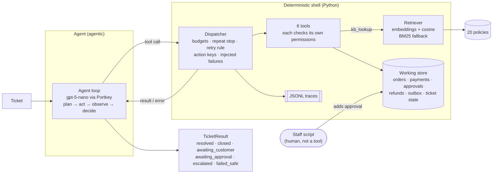
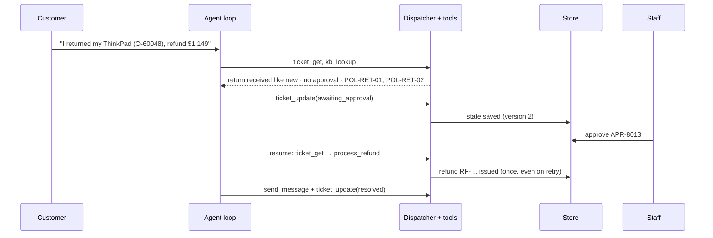

# OP-US Support-Ticket Triage Agent

Team OP-US · Agentic AI, UT Austin, Fall 2026

An AI agent that reads customer support tickets for a fictional online store, finds the
relevant store policies, takes safe actions (refunds, cancellations, replies), and saves each
ticket in a clear end state. It can also pause for missing information or a staff approval
and resume later.

**Core rule: Python owns permissions and control flow, not the model.** The model decides
*how* to handle a ticket; Python decides *what is allowed*. Nothing written in a ticket or a
policy can grant a permission, and a refund only happens with a staff approval for the exact
order and amount.

---

## How it works



### Pause for approval, then resume (the demo path, ticket T-0039)



---

## Tech stack

| Area | Choice |
|---|---|
| Language | Python 3.12 |
| Environment | [uv](https://docs.astral.sh/uv/) with `pyproject.toml` + `uv.lock` |
| LLM | `gpt-5-nano` through **Portkey** (OpenAI-compatible API) |
| Embeddings | `text-embedding-3-small` through Portkey |
| Keyword search | `rank-bm25` (BM25Okapi) |
| Data validation | Pydantic v2, strict models (extra fields rejected) |
| Agent loop | Plain Python loop with native function calling (no agent framework) |
| State | JSON files in `runtime/`, written after every action |
| Tests | pytest |

---

## Repository layout

```
agent/
  config.py          paths, model IDs, per-ticket limits (8 model calls, 8 tool calls, ...)
  schemas.py         TicketResult, categories, statuses, team routing, ToolError / StopRun
  store.py           working store in runtime/, safe writes, balance and lookup helpers
  tools.py           the 6 tools and their permission checks
  dispatcher.py      the only path from a model tool call to a tool
  progress.py        durable budgets and execution checkpoints alongside action receipts
  retrieval.py       policy chunks, embeddings + cosine, BM25 fallback
  llm.py             Portkey client and embeddings
  agent.py           the agent loop: classify, act step by step, check the reply, pause/resume
  baseline.py        single pass: one retrieval, one model call
  eval_run.py        runs the agent and the baseline on a split and scores them against the labels
  judge.py           LLM judge: does each sent reply state the label's expected facts, without unsupported claims
  eval_retrieval.py  Hit@3 / Recall@3 / Precision@3 / MRR for retrieval
  trace.py           JSONL traces, card numbers removed
  staff.py           human staff actions: reset, approve, status
  prompts/           versioned prompts (classify_v1, agent_v2, check_v1, baseline_v1, judge_v1, ...)
data/
  synthetic/         160 tickets, labels, provenance, store, splits (dev 44 / test 115 / demo 1)
  generate.py        rebuilds data/synthetic/ from the Bitext + Kaggle sources
  check_dataset.py   checks every label against the store records
policies/            20 store policies (POL-*.md, v1.1)
tests/               pytest suite (no API key needed)
results/eval/        measured evaluation runs (per-ticket rows and traces stay local)
ui/
  api/               FastAPI routes and RealAdapter (adapter.py, real_adapter.py, evaluation.py, grading.py)
  api_tests/         API and adapter tests
  web/               React/Vite console; demo tickets in src/demo-scenarios.ts; see ui/README.md
```

### Where the technical report's evidence lives

Paths for each part of the system and evaluation described in the technical report (results correspond to commit `88f4270`).

| Component | Files |
|---|---|
| States, routing, tool contracts | `agent/schemas.py`, `agent/tools.py` |
| Budgets, dispatch, durable state | `agent/config.py`, `agent/dispatcher.py`, `agent/progress.py`, `agent/store.py` |
| Agent and baseline | `agent/agent.py`, `agent/baseline.py`, `agent/llm.py`, `agent/prompts/` |
| Retrieval | `agent/retrieval.py`, `agent/eval_retrieval.py`, `policies/`, `results/eval/retrieval.json` |
| Fixtures and labels | `data/synthetic/` (`tickets.jsonl`, `labels.jsonl`, `store.json`, `splits.json`, `provenance.jsonl`) |
| Fixture generation and checks | `data/generate.py`, `data/check_dataset.py` |
| Evaluation and judging | `agent/eval_run.py`, `agent/judge.py` |
| Primary test comparison | `results/eval/agent-test-v2.json`, `results/eval/baseline-test-v2.json` |
| Development runs | `results/eval/agent-dev-v1.json`, `agent-dev-v2-low.json`, `agent-dev-v2-medium.json`, `agent-dev-v2-high.json` |
| Staff approval and tracing | `agent/staff.py`, `agent/trace.py`, `data/synthetic/demo_staged_approval.json` |
| API and console | `ui/api/`, `ui/web/src/`, `ui/README.md` |
| Tests and lock files | `tests/`, `ui/api_tests/`, `uv.lock`, `ui/web/package-lock.json` |

The committed fixtures are enough to run everything. Rebuilding them with `data/generate.py` also needs the original Kaggle and Bitext CSV files outside the repository.

---

## Implementation

### Tools

The model can call only these six. Each one checks permissions itself against the store,
under a context Python builds from the ticket (the model never passes a customer ID).

| Tool | What it does | Key checks |
|---|---|---|
| `kb_lookup(query, k)` | Search the policies | k ≤ 3, ≤ 4,000 characters, weak-evidence flag |
| `ticket_get(ticket_id)` | Ticket, linked orders, payments, approvals, refunds, version | Only this ticket; other customers' orders are hidden |
| `send_message(ticket_id, body, citations)` | Reply to the customer | Stored email only, real policy IDs, no card numbers |
| `process_refund(order_id, cents, approval_id)` | Refund an order | Exact unused staff approval, remaining balance, return received, not final sale |
| `cancel_order(order_id)` | Cancel and reverse payment | Owned, unshipped (`processing`) orders only |
| `ticket_update(result, expected_version)` | Save the final `TicketResult` | Version check, allowed transitions, receipts belong to the ticket, `resolved` needs a message receipt, `closed` needs customer confirmation |

### Dispatcher rules

- **Budgets:** 8 model calls and 8 tool calls per ticket, counted across resumes for both systems. Attempts are charged before execution and saved with the working store, so an interruption cannot restore an older allowance. Unknown tools and invalid arguments do not consume tool calls.
- **Repeat stop:** the third identical model-requested call (same tool, same arguments in any order) ends the run as `failed_safe`. Python's mandatory ticket re-reads consume the lifetime tool budget without counting as model repetition.
- **Retries:** a temporary error is returned with `retryable: true`; the model may retry once per ticket.
- **Action keys:** built by Python from ticket + tool + arguments. Repeating an action returns the saved receipt, so a retry can never refund twice.
- **Recovery:** the working store keeps the current budget and agent checkpoint atomically with receipts. The checkpoint JSON file is a readable compatibility copy. Legacy baseline runs without saved counters need a fresh snapshot before another run.
- **Injected failures:** test tickets can simulate timeouts, version conflicts and embedding outages. A timeout on a write happens *after* the write (the reply is "lost"), which tests the action keys.

### Retrieval

- Each policy section (Scope, Conditions, Rules, Exceptions) is a chunk: 80 chunks.
- Policies are ranked by their best-matching section; the top 3 distinct policies come back as Conditions + Rules + Exceptions, within 4,000 characters.
- Embeddings + cosine similarity is the main method; BM25 takes over if embeddings fail.
- Vectors are cached in `runtime/kb_index.json`; only sections whose text changed are re-embedded.

Dev split, using each ticket's own text as the query:

| Method | Hit@3 | Recall@3 | Precision@3 (max 0.500) | MRR |
|---|---|---|---|---|
| Embeddings | 0.864 | 0.723 | 0.333 | 0.777 |
| BM25 | 0.727 | 0.572 | 0.265 | 0.663 |

### Dataset

160 synthetic tickets: customer text from the Bitext support dataset, ticket metadata
(priority, channel, product) from the Kaggle support-ticket dataset, plus matching fictional
orders, payments, approvals and refunds so every decision can be checked against store data.

- 7 categories → 4 teams (Delivery, Returns, Billing, Human Review)
- All 6 end states, multi-turn conversations, prompt injections, fraud patterns, policy conflicts, tool failures
- Labels (expected category, team, policies, actions, final state) are kept separate from agent input

---

## Getting started

```bash
# 1. Install uv once: https://docs.astral.sh/uv/getting-started/installation/
uv sync                                   # creates .venv with the pinned dependencies

# 2. Add the course key (never commit this file)
echo 'PORTKEY_API_KEY=...' > .env

# 3. Run the tests (no key needed)
uv run pytest

# 4. Measure retrieval (uses the key); --save shows the result in the console
uv run python -m agent.eval_retrieval --split test --save

# 5. Evaluate the agent and the baseline (uses the key); rerun the same command to finish an interrupted run
uv run python -m agent.eval_run --split dev --tag local                     # 44 dev tickets
uv run python -m agent.eval_run --split test --tag local                    # 115 test tickets
uv run python -m agent.eval_run --split dev --tag local-high --reasoning-effort high
uv run python -m agent.eval_run --split test --tag local --rescore          # re-score local rows/traces, no model calls
uv run python -m agent.judge --runs agent-test-local,baseline-test-local    # judge the saved replies

# 6. Staff actions used in the demo
uv run python -m agent.staff reset              # fresh working store in runtime/
uv run python -m agent.staff approve APR-8013   # staff approves the T-0039 refund
uv run python -m agent.staff status T-0039      # show the saved ticket state

# Rebuild and check the dataset (needs the raw Bitext/Kaggle CSVs outside the repo)
python data/generate.py && python data/check_dataset.py
```

### Evaluation cache and saved results

New evaluations record an execution manifest with the code, prompts, model settings, ticket inputs,
store snapshot and policies. Repeating the same command resumes only when those inputs match.
Use a new `--tag` after changing code/settings, or `--redo` to replace an existing run. A redo discards
the old rows, traces and judge verdicts. Label changes require explicit `--rescore` or a fresh run;
semantic verdicts are also checked against the exact replies, labels, policies and judge configuration.

The committed `results/eval/*.json` files are historical measured summaries. Their original per-ticket
rows, traces and manifests stay in the ignored run folders. Retain those folders for reproducibility.
A summary without its original evidence cannot be resumed, rescored or judged; restore its evidence
or choose a fresh tag. Historical runs without manifests cannot be silently reused for new execution.

Deterministic success and unsupported-claim checks describe the rule-based checks. Semantic judge
findings are reported separately; a deterministic pass does not establish that every reply is grounded.
